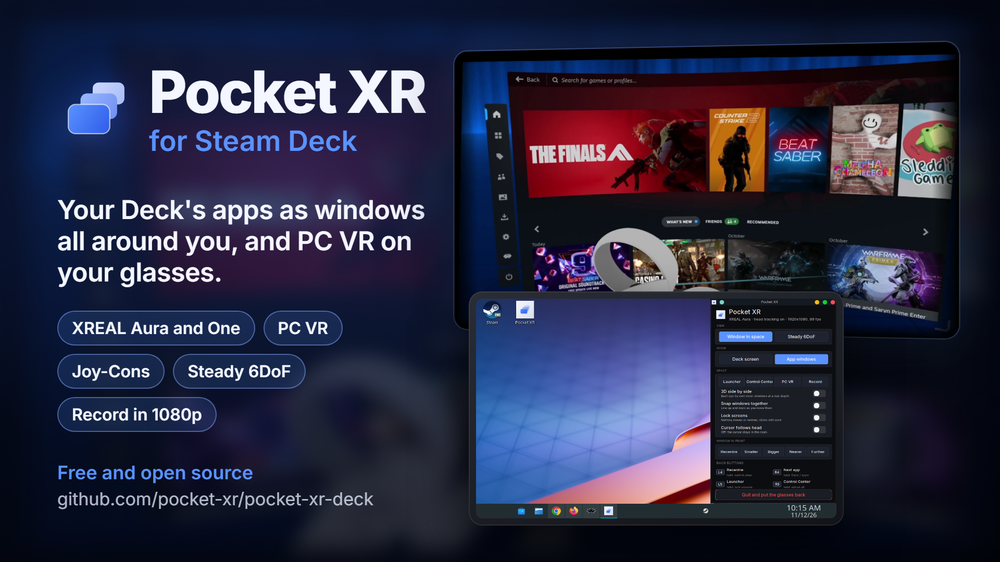

# Pocket XR for Steam Deck

Your Steam Deck's screen and apps on your XR glasses, held still in space as you turn your head. On glasses that
track position, they stay in place as you move around too.

It is the Steam Deck version of [Pocket XR](https://github.com/pocket-xr/pocket-xr), the free and open
source spatial desktop for Android phones. Same glasses, same rules, no account and no paid tier.

[](https://youtu.be/wG-jDG43XUo)

**Watch it in action:** [Pocket XR for Steam Deck on YouTube](https://youtu.be/wG-jDG43XUo) (52 seconds).

> **This is the first version, so expect bugs.** Please tell me what breaks and what you'd like next: open an
> [issue](https://github.com/pocket-xr/pocket-xr-deck/issues), or start a
> [discussion](https://github.com/pocket-xr/pocket-xr-deck/discussions). I put out updates almost every day, and
> your feedback decides what comes first. To update, run the install line again.

It works in both Desktop Mode and [Gaming Mode](#gaming-mode). It's set up for the same XREAL and VITURE glasses as
Pocket XR on Android (see [Glasses](#glasses)). Most haven't been tried on a Deck yet, so if you have any of them,
please give it a go and send a "works" or "doesn't" with your log: that's the fastest way to make it great on yours.

New in 0.7.0: it also runs on **Ubuntu** 24.04 and 26.04, so far tried only in a test setup, not on a real Ubuntu
computer or with glasses. See [Ubuntu and other Linux](#ubuntu-and-other-linux).

## Install

On the Deck, switch to Desktop Mode, open Konsole and paste:

```bash
curl -L https://github.com/pocket-xr/pocket-xr-deck/releases/latest/download/pocket-xr-deck.tar.gz | tar xz -C /tmp && /tmp/pocket-xr-deck/install.sh
```

Pocket XR then appears on the desktop and in the app menu, and starts by itself in Gaming Mode. No password is
needed. It installs into your home folder, so SteamOS updates leave it alone. Run the same line again to update,
or open **Update Pocket XR**, on the desktop and in the app menu, which runs it in a terminal for you (suggested by
Pierre Zammit). If Decky's plugins folder belongs to root and Pocket XR's Quick Access panel there is older, the
installer asks whether to update the panel too, with your password, and restarts Decky to load it.

Pocket XR's own Desktop Mode view needs KDE Plasma on X11. The SteamOS 3.9.5 Decks we have seen start Desktop Mode
on Wayland, so on those use Pocket XR in Gaming Mode. Please don't switch SteamOS's desktop to X11 for it: a tester's
Deck had trouble after that switch (a trackpad that would not click, then hangs at shutdown and boot). If you already
switched, this in Konsole puts Wayland back, from the next time you switch to Desktop:
`steamosctl set-default-desktop-session plasma.desktop` (or press **Put the desktop back to Wayland** in Quick
Access). Your Deck on your phone (below) needs Wayland.

Not on SteamOS? See [Ubuntu and other Linux](#ubuntu-and-other-linux). On a Plasma Wayland desktop (the default on
CachyOS, Bazzite and others) log out and pick **Plasma (X11)**, or use Gaming Mode. If a back button also opens your
desktop's own menu, your system has mapped that button too: clear it in Steam's desktop controller layout or your
handheld tool (like HHD or InputPlumber).

If you have [Decky Loader](https://decky.xyz), you can add Pocket XR's panel to Quick Access in Gaming Mode. In
Gaming Mode, open Decky's settings and turn on **Developer mode**. Then under **Developer**, choose **Install Plugin
from URL** and enter:

```
https://github.com/pocket-xr/pocket-xr-deck/releases/latest/download/pocket-xr-decky.zip
```

To remove it: `~/.local/share/pocket-xr-deck/uninstall.sh`

### Ubuntu and other Linux

New in 0.7.0: Pocket XR also runs on Ubuntu 24.04 and 26.04, on GNOME's usual Wayland desktop and on X11.

> **Tried only in a test setup so far:** Ubuntu ran in headless GNOME sessions under WSL on a Windows PC, with a
> second virtual monitor standing in for the glasses. It has not been tried on a real Ubuntu computer or with
> glasses yet. If you try it, please send a "works" or "doesn't" with your log (Send logs to Mike).

To install, open a terminal (Ctrl+Alt+T) and paste this. Ubuntu has `wget` but not always `curl`:

```bash
wget -qO- https://github.com/pocket-xr/pocket-xr-deck/releases/latest/download/pocket-xr-deck.tar.gz | tar xz -C /tmp && /tmp/pocket-xr-deck/install.sh
```

It asks two questions, each answered with Enter (yes) and then your password:

1. **The system pieces Ubuntu leaves out**, if any are missing: Python's Tk for the control panel, and SDL2 on a
   minimal install (`sudo apt-get install python3-tk libsdl2-2.0-0`).
2. **The glasses' USB permission**: one udev rule, so head tracking can read XREAL Air and VITURE glasses. The XREAL
   Aura doesn't need it. If you said no, or want to add it by hand, this is the one sudo step:

   ```bash
   printf '%s\n' 'KERNEL=="hidraw*", ATTRS{idVendor}=="3318", TAG+="uaccess"' 'KERNEL=="hidraw*", ATTRS{idVendor}=="35ca", TAG+="uaccess"' 'KERNEL=="hidraw*", ATTRS{idVendor}=="057e", TAG+="uaccess"' | sudo tee /etc/udev/rules.d/70-pocket-xr.rules && sudo udevadm control --reload-rules && sudo udevadm trigger --subsystem-match=hidraw
   ```

   Then unplug the glasses and plug them back in.

Everything else goes in your home folder, as on the Deck. On GNOME the installer also adds shortcuts for the Deck's
back buttons: **Super+Alt+R** recentres, **Super+Alt+V** switches Window in space and Steady 6DoF, **Super+Alt+L**
opens the launcher, **Super+Alt+C** the Control Center. Then plug in your glasses and open **Pocket XR** from the app
menu. Run the same line again to update; `~/.local/share/pocket-xr-deck/uninstall.sh` removes it.

What you get:

- **GNOME on Wayland** (Ubuntu's default): your main screen in the glasses, held still in space. App windows each in
  their own place aren't there yet; choosing them shows the main screen. GNOME shows its screen sharing icon while
  Pocket XR runs: that's how Pocket XR sees the screen.
- **X11** (Ubuntu 24.04's "Ubuntu on Xorg", Plasma (X11)): the same as on the Deck, app windows included.
- Plasma on Wayland and other Wayland desktops: not yet.

Gaming Mode, Quick Access and the back buttons are the Deck's own. What was checked and how: `docs/UBUNTU.md`.

## Use

1. Plug your glasses into the Deck's USB-C port.
2. Open **Pocket XR**. Your glasses show the Deck's screen in front of you. A control panel opens on the Deck.
3. Hold still for a moment now and then. The head tracking learns its zero point while you are still.

The control panel:

- **View**
  - **Window in space**: the screen stays where it is while you turn your head.
  - **Steady 6DoF**: the glasses hold the picture in place as you lean and walk around (see below).
- **Show**
  - **Deck screen**: the whole Deck screen as one window.
  - **App windows**: each open app as its own window, side by side around you.
- **Adjust**: Recentre, Smaller and Bigger, Nearer and Further.
- **Screen gap**, in Steady 6DoF: the space between screens, 0 to 120 pixels in steps of 10 (40 to start).
- **Readability**: off to start. On, it shows the Deck screen alone, 30 degrees wide and in front of you, so each
  of the Deck's 1280 pixels across lands on about one pixel of 1080p glasses and text is sharp. The Deck keeps its
  own 1280x800 resolution, already lower than the 1440x810 Pocket XR for Mac and Windows use for this. In Steady
  6DoF the screen is drawn at exactly its own pixels. Off puts back what it changed (Deck screen or App windows, the
  screen's size and place, Steady's size). Not yet tried with glasses.
- **Look at a window to bring it to the front.** In App windows, look at a window for a moment and it comes to
  the front on the Deck's screen, so touch, the trackpads and the keyboard work on it.
- **Record**, in the Control Center and on the control panel: a 1080p video of exactly what you see, PC VR included,
  saved in your Videos folder under Pocket XR. A red dot blinks in the glasses while it records; it is not in the
  video. Press again to stop.
- **Quit and put the glasses back.** Every setting Pocket XR changed on the glasses is put back as it was.

The Deck's back buttons work at any time, alongside Steam's controls:

| Button | Tap | Hold |
| --- | --- | --- |
| L4 | Recentre | Switch between Window in space and Steady 6DoF |
| R4 | Next app window | Switch between Deck screen and App windows |
| L5 | Launcher | Lock screens |
| R5 | Control Center | Adjust all |

**Recentre** makes where you look straight ahead, up or down as well as sideways: lying back or looking down at a
desk, the screen comes to where you look. The picture stays level (the head's roll is not taken). Switching the view
does the same. (0.7.1 took the up or down only past 15 degrees, so near level it moved the screen sideways alone.)

**No back buttons?** A Steam Controller or another pad has no L4 or R4, but Steam Input can map any of its buttons to
a keyboard key, and Pocket XR does the back buttons' jobs from keys too: the media key **Stop** recentres and
**Next** switches the view (in Gaming Mode, the next mode). Map a button to one of them in the controller's Steam
Input layout, in its keyboard's media keys. **Pause** and **Scroll Lock** do the same from a real keyboard; Steam
Input's keyboard doesn't have them (Pierre Zammit's screenshots). Other keys and the other actions (next app, launcher, Control Center, lock, adjust all) can be set in the
`keys` setting, in `~/.config/pocket-xr-deck/settings.json` (Desktop Mode) and `gaming.json` (Gaming Mode), for
example `"keys": {"recentre": "KEY_F13", "launcher": ["KEY_PAUSE", "KEY_HOME"]}`. Asked for by Pierre Zammit. In Gaming Mode the
keys are read from gamescope's screen, where Steam Input sends them: on a Deck, Stop, Next, Pause and Scroll Lock
sent there were each seen once (by a test, not yet with a Steam Controller). In Desktop Mode they are read
from the keyboard devices: the Deck's own keyboard works, a pad's keys through Steam Input are not tried yet.
## Gaming Mode

Plug your glasses in and play as usual. Pocket XR starts by itself in Gaming Mode and shows the whole Gaming Mode
picture, your games and Steam's menus, as a big screen held still in front of you as you turn your head.

- **Screen in space** (glasses with head tracking): the screen stays put while you turn your head.
- **Steady** (glasses that hold the picture themselves, like the XREAL Aura): the glasses hold the screen in place
  as you lean and move around, in 6DoF.
- **Off**: the picture as it is, moving with your head.

Change them in **Quick Access, Decky, Pocket XR**, which also has the screen's **size**, its **curve**, **Readability**
and **Recentre**. Without
Decky, use the back buttons: **hold L4** to recentre, **hold R4** to switch between the screen in space and Steady
(or off, on glasses without Steady). A quick tap still reaches your game.

**Stick clicks**, in every game with no Steam Input setup (on the Deck's own controller): **hold L3** for a second to
recentre, **hold R3** to switch the view, and **click L3 three times** to calibrate; the calibration starts 5 seconds
later, so you can take the glasses off and lay them down. One or two clicks, and shorter presses, still reach the game.
They are on at first; **Stick clicks** in Quick Access turns them off. Asked for by Pierre Zammit. Checked by tests;
not yet tried on a Deck. Other controllers: Steam Input sends their buttons to games, not to Pocket XR, so use the Stop
and Next keys above. Steam's **Guide Button Chord Layout** (Steam's controller settings) applies in every game, so a
chord there (for example Steam + L3) mapped to Stop may save setting it per game; not yet tried.

**Taps on the glasses**, for any controller or with the Deck put down: tap the glasses' frame **twice** to recentre,
**three times** to switch the view, at about 2 taps a second (1.5 to 5 a second work), holding your head still.
Pocket XR reads the taps from the glasses' own motion sensor: a tap is a small jolt that starts suddenly, and jolts
during fast head turns, slower ones and longer ones are left out. Off at first: turn on **Taps on the glasses** in
Quick Access. Asked for by Pierre Zammit. With 0.7.6 his taps on the top of the frame mostly didn't count; 0.7.7
takes softer taps (his recorded ones count) and puts every jolt in the log with why it did or didn't count.
A few steps of walking with sharp heel strikes could count as taps; not yet tried while walking.

**Use the glasses' buttons**, in Quick Access (XREAL Air family, including the XBX): Pocket XR lets go of the glasses
until you turn it off again, so their own buttons can work, for brightness say. Head tracking pauses meanwhile.
Asked for by Pierre Zammit, whose XBX's buttons don't work while Pocket XR reads the glasses. With 0.7.6 they came
back, but only 1 to 4 minutes later, when the glasses reset themselves (they blink off and on). So: set the mode to
Off, turn this on, wait for the glasses to blink, adjust them, turn this off, then pick a mode. From 0.7.7 it also
resets the glasses over USB at once (as unplugging them), when the installer's USB permission is there: it offers
a udev rule for that, `/etc/udev/rules.d/71-pocket-xr-usb.rules`, with your password, for XREAL and VITURE glasses
only. Without it, the wait above. Not yet tried on a Deck.

Good to know:

- The panel needs a recent Decky Loader (3.3 or newer). An older one may not show up in Quick Access at all with
  current Steam versions; update it from decky.xyz.
- Steam's own overlays, like Quick Access and notifications, stay fixed in front of you rather than on the screen
  in space. That's how gamescope, Steam's Gaming Mode compositor, draws them: Pocket XR's effect only reaches the
  game's picture.
- **The mouse pointer:** gamescope draws its own cursor after Pocket XR's effect too, where the pointer is on the
  Deck's screen, so on a moved or resized screen it isn't over what it points at. Pocket XR now draws a pointer of
  its own on the screen in space, a white arrow, where it lines up: follow that one. gamescope's cursor still shows,
  and Pocket XR can't move it. Pocket XR's arrow stays while the game shows a cursor, even when the pointer is
  still (0.7.1 hid it after 3 seconds, leaving only gamescope's). Reported by Pierre Zammit. On a Deck, gamescope compiled the new effect and the pointer's position was read from gamescope's
  screen; not yet seen with glasses.
- **Calibrate (hold still)**, in Quick Access: take the glasses off and lay them on something still for 4 seconds,
  and the slow drift to one side they may have is measured, taken out and saved for those glasses. A notification
  says when it starts and how it went. Pocket XR also keeps learning
  it whenever you hold still. Not yet tried with glasses.
- App windows all around you are a Desktop Mode feature. In Gaming Mode you get one screen.
- **Readability** in Gaming Mode makes the screen 30 degrees wide, the sharpest for a game drawn 1280 pixels wide
  (the Deck's own resolution). It can't make a game's text larger: the game picks its own resolution, so for larger
  text choose a larger text or interface size in the game. Off puts the size back. Not yet tried with glasses.
- Unplug the glasses before restarting the Deck. Once, after a restart with the glasses plugged in, the Deck's own
  screen stayed black until a full power-off.

## PC VR

Play SteamVR games from your Windows gaming PC on your glasses, streamed over Wi-Fi. The PC runs the game; the Deck
only shows it, so nothing extra goes on the Deck. It's new, so it's a beta.

1. On your **Windows PC** (not the Deck), install Steam and SteamVR, then the
   [Pocket XR PC helper](https://github.com/pocket-xr/pocket-xr/releases/tag/pc-helper-v1.0), the same one
   Pocket XR on Android uses. Keep it running.
2. Put the PC and the Deck on the same network. A PC on a cable to the router and the Deck on 5 GHz Wi-Fi works best.
3. On the Deck, open PC VR from the launcher, the Control Center or the control panel. The first time, your PC asks
   whether to allow this Steam Deck: say yes.
4. Pocket XR shows a loading room while SteamVR starts, then opens into the game.

In PC VR the buttons belong to the game, except one: hold L5 or R5 for two seconds to go back to your Space. A ring
fills on the card while you hold; let go before it fills to stay in the game.

In PC VR the Deck is a pair of controllers: its left half the left hand, its right half the right. The triggers,
L1 and R1 (grip), both sticks, A, B, X, Y and the menu button go to the game. Drag on a trackpad to aim that hand,
for pointing at a menu; press the pad in to point it straight ahead again.

Joy-Cons work as PC VR's controllers too, and turn with your hands. Pair them with the Deck in Desktop Mode's Bluetooth
settings first. A connected Joy-Con takes over its hand, so one Joy-Con and the Deck's other half work together.

| Joy-Con | Controller |
| --- | --- |
| ZL, ZR | Triggers |
| L, R | Grip |
| Stick, and pressing it in | Thumbstick |
| A, B on the right; right and up arrows on the left | A, B; X, Y |
| Minus, Plus | Menu |
| Capture (left), Home (right) | Point that Joy-Con straight ahead again |

Hold them like remotes, pointing forward. Each one points ahead by itself when it starts. Over time its aim drifts
sideways a little; press Capture or Home to point it ahead again. Steam turns the Joy-Cons' motion sensors off;
Pocket XR turns them on while PC VR runs, and off again after.

## Your Deck on your phone

New: Pocket XR on your phone can show this Deck's screens as its PC screens, up to three, each at the shape of its
window. Tried with one phone so far; that first try showed a broken picture (SteamOS's HEVC encoder), so the Deck now
checks each encoder and sends H.264. In Desktop Mode the Deck answers the phone by itself, with nothing else to
install. Put both on the same network. The first time, the Deck asks whether to allow the phone. It replaces the
Pocket XR PC Screens app; the installer switches that app off. How it works and what has been checked:
`docs/HOST-DECK.md`.

## Your PC in the glasses

New, and not yet tried on a Deck: **Show a PC** (on the launcher card and the control panel) opens a screen of your
Windows PC as a window in the Space, up to three, through Moonlight and the PC's Apollo set up by the Pocket XR PC
helper. How it works: `docs/PC-SCREENS-DECK.md`.

## More

Holding the pointer against the right edge of the Deck's screen for a second also recentres.

The mouse pointer is drawn in the glasses on the window it is over. It stays on the Deck's screen: past its right
edge you could not see or use it.

### Take your layouts along

**Share layouts** and **Import layouts**, in the panel and in the Control Center under Saved layouts, move your
window presets between the Deck and Pocket XR on Android. Share layouts saves them to one small file in Downloads.
Import layouts reads the newest one there, from the Deck or from your phone. Each window finds the same app by name;
apps that aren't on this Deck are left out, and Pocket XR says which.

### Languages

Pocket XR speaks English, Korean, Japanese, Chinese (simplified and traditional), Spanish, Portuguese (Brazil),
French, German, Italian and Russian. It follows Steam's language, in Desktop Mode too. To pick another, start it with
`POCKET_XR_LANG=ko` (or `ja`, `zh_CN`, `fr` and so on). The translations are new: if something reads oddly, tell me.

## Glasses

The same glasses as Pocket XR on Android:

| Glasses | Head tracking | Steady mode in 6DoF | Tried on a Deck |
| --- | --- | --- | --- |
| XREAL Aura | Yes | Yes. Pocket XR turns the Aura's Spatial Anchor on and off for you. | Yes |
| XREAL One, One Pro, One Pro+, 1S | Yes | With the XREAL Eye. You turn 6DoF on in the glasses' menu when asked. | Not yet: please try it |
| XREAL Air, Air 2, Air 2 Pro, Air 2 Ultra | Yes | No | Not yet: please try it |
| XREAL XBX A01, A01+ | Yes (A01+, Gaming Mode, by a tester with 0.7.2); the A01 not yet tried | No | Yes (A01+) |
| VITURE Beast | Yes | No (waits on VITURE's SDK) | Not yet: please try it |
| Other VITURE glasses | Experimental, off until you turn it on in the panel | No | Not yet: please try it |
| Other glasses | No, the windows are shown flat | No | Not yet: please try it |

**XR Gaming installed too?** Its driver, `xrDriver`, talks to the same glasses and sets the game screen's effect in
Gaming Mode itself, so the two get in each other's way. Removing the XR Gaming plugin from Decky leaves the driver
running (seen on a tester's Deck). Pocket XR says so in the panel and in Quick Access when it sees it. To stop it, run
this in Konsole: `systemctl --user disable --now xr-driver`, or press **Stop XR Gaming's driver** in Quick Access.

Settings on the glasses themselves, as on Android:

- **XREAL Aura:** nothing to do. Pocket XR turns Spatial Anchor off in Window in space, and on in Steady 6DoF.
- **XREAL One series:** use **Follow** mode and turn **Stabilizer off** in the glasses' menu. Otherwise the glasses
  and Pocket XR both move the picture.

**A "KDE Wallet" window pops up when you plug in the glasses?** KDE asks its wallet for network passwords each time
the glasses' USB network appears. Pocket XR doesn't need it. To stop it: System Settings, KDE Wallet, untick
"Enable the KDE wallet subsystem".

If your glasses are on the list but don't work, please open an issue with the log from
`~/.local/state/pocket-xr-deck/pocket-xr.log`.

## What it sends to the glasses

Pocket XR reads the glasses' motion. It sends a setting only on XREAL glasses with a control link (the Aura and the
One series), and only the commands Pocket XR on Android has already proven: 2D and 3D, Ultrawide, screen size,
Spatial Anchor and the canvas recentre. It never sends a firmware command or a guessed one. On the Air and VITURE
glasses it sends only the start and stop of the motion stream.

## Feedback

It's still early, and I put out updates almost every day. Bug reports, glasses reports ("it works on my One Pro", or
"it doesn't"), and ideas all help:

- **Something broke?** Press **Send logs to Mike**, in the panel in Desktop Mode or in Quick Access in Gaming Mode. It
  makes one zip of Pocket XR's logs in Downloads, with emails, Wi-Fi and Bluetooth names, IP addresses and your
  computer's name taken out, and opens an email to me with it. In Gaming Mode, send the zip from Desktop Mode. Or open
  an [issue](https://github.com/pocket-xr/pocket-xr-deck/issues) and attach the zip.
- **An idea or a question?** Start a [discussion](https://github.com/pocket-xr/pocket-xr-deck/discussions).

### Thanks

Fixes and new support that came from your reports:

- Thanks to Pierre Zammit for his Steam Deck logs with the XREAL XBX A01+, which led to head tracking for the XBX A01
  and A01+ (0.6.0).
- Thanks to Pierre Zammit again for testing 0.6.0 with his A01+ and sending logs, which led to the XBX changes and
  the XR Gaming check in 0.6.1, and for his 0.6.1 logs, which showed the motion arriving and led to 0.6.2's
  changes.

## Support

[](https://ko-fi.com/mikehaye)

Enjoying Pocket XR? You can buy me a beer on [Ko-fi](https://ko-fi.com/mikehaye). It's never required; a star or a
glasses report helps just as much.

## Build and test

```bash
python3 tests/test_offline.py   # checks that need no glasses or screen
python3 tests/test_host.py      # the Deck host's parts that need no Deck
native/host/build.sh            # the host's programs (in WSL Ubuntu or Linux)
./make-release.sh               # dist/pocket-xr-deck.tar.gz
```

On a Deck, `tools/host_check.py` checks a running host from the phone's side.

`docs/FEASIBILITY.md` covers why the Deck version is built this way, how it compares to Breezy Desktop, and the test
results on a real Deck.

## Licence

GPL-3.0, the same as Pocket XR. The glasses' protocols are written in our own words from Pocket XR's notes, which
credit the public, MIT licensed write-ups they come from.

The font is Inter 4.1, Copyright (c) 2016 The Inter Project Authors (https://github.com/rsms/inter), under the SIL
Open Font License 1.1 (https://openfontlicense.org): `assets/fonts/` holds its static Regular and Medium files,
unmodified, as Pocket XR on Android bundles them.

PC VR uses ALVR's client library (https://github.com/alvr-org/ALVR, MIT licence), built from the same source as
Pocket XR on Android, and the Deck's own FFmpeg to decode the video.

The Deck host (`pocketxr/host`, `native/host`) ports its protocol from Sunshine (https://github.com/LizardByte/Sunshine)
and Apollo (https://github.com/ClassicOldSong/Apollo), both GPLv3, and is compatible with Moonlight. It builds in
moonlight-common-c's ENet fork (https://github.com/moonlight-stream/moonlight-common-c; ENet by Lee Salzman, MIT
licence) and nanors (https://github.com/sleepybishop/nanors; Joseph Calderon, MIT licence), whose licence texts are
in `native/host/third_party/`, and KDE's screencast protocol description (LGPL-2.1-or-later). It uses the Deck's own
FFmpeg, PipeWire, OpenSSL and Opus.
