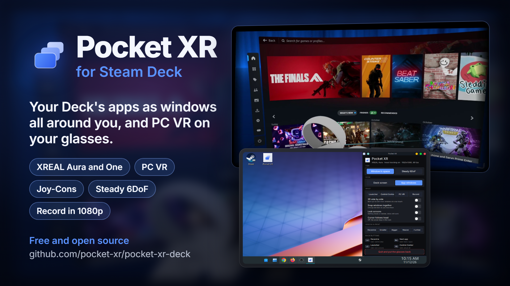

# Pocket XR for Steam Deck

Your Steam Deck's screen and apps on your XR glasses, held still in space as you turn your head. On glasses that
track position, they stay in place as you move around too.

It is the Steam Deck version of [Pocket XR](https://github.com/pocket-xr/pocket-xr), the free and open
source spatial desktop for Android phones. Same glasses, same rules, no account and no paid tier.

[](https://youtu.be/wG-jDG43XUo)

**Watch it in action:** [Pocket XR for Steam Deck on YouTube](https://youtu.be/wG-jDG43XUo) (52 seconds).

> **This is the first version, so expect bugs.** Please tell me what breaks and what you'd like next: open an
> [issue](https://github.com/pocket-xr/pocket-xr-deck/issues), or start a
> [discussion](https://github.com/pocket-xr/pocket-xr-deck/discussions). I put out updates almost every day, and
> your feedback decides what comes first. To update, run the install line again.

It runs in Desktop Mode. Gaming Mode is not supported yet. It's set up for the same XREAL and VITURE glasses as
Pocket XR on Android (see [Glasses](#glasses)). Most haven't been tried on a Deck yet, so if you have any of them,
please give it a go and send a "works" or "doesn't" with your log: that's the fastest way to make it great on yours.

## Install

On the Deck, switch to Desktop Mode, open Konsole and paste:

```bash
curl -L https://github.com/pocket-xr/pocket-xr-deck/releases/latest/download/pocket-xr-deck.tar.gz | tar xz -C /tmp && /tmp/pocket-xr-deck/install.sh
```

Pocket XR then appears on the desktop and in the app menu. No password is needed. It installs into your home
folder, so SteamOS updates leave it alone. Run the same line again to update.

To remove it: `~/.local/share/pocket-xr-deck/uninstall.sh`

## Use

1. Plug your glasses into the Deck's USB-C port.
2. Open **Pocket XR**. Your glasses show the Deck's screen in front of you. A control panel opens on the Deck.
3. Hold still for a moment now and then. The head tracking learns its zero point while you are still.

The control panel:

- **View**
  - **Window in space**: the screen stays where it is while you turn your head.
  - **Steady 6DoF**: the glasses hold the picture in place as you lean and walk around (see below).
- **Show**
  - **Deck screen**: the whole Deck screen as one window.
  - **App windows**: each open app as its own window, side by side around you.
- **Adjust**: Recentre, Smaller and Bigger, Nearer and Further.
- **Look at a window to bring it to the front.** In App windows, look at a window for a moment and it comes to
  the front on the Deck's screen, so touch, the trackpads and the keyboard work on it.
- **Record**, in the Control Center and on the control panel: a 1080p video of exactly what you see, PC VR included,
  saved in your Videos folder under Pocket XR. A red dot blinks in the glasses while it records; it is not in the
  video. Press again to stop.
- **Quit and put the glasses back.** Every setting Pocket XR changed on the glasses is put back as it was.

The Deck's back buttons work at any time, alongside Steam's controls:

| Button | Tap | Hold |
| --- | --- | --- |
| L4 | Recentre | Switch between Window in space and Steady 6DoF |
| R4 | Next app window | Switch between Deck screen and App windows |
| L5 | Launcher | Lock screens |
| R5 | Control Center | Adjust all |

## PC VR

Play SteamVR games from your Windows PC on your glasses, streamed over Wi-Fi. It's new, so it's a beta.

1. On your PC, install Steam and SteamVR, then the
   [Pocket XR PC helper](https://github.com/pocket-xr/pocket-xr/releases/tag/pc-helper-v1.0), the same one
   Pocket XR on Android uses. Keep it running.
2. Put the PC and the Deck on the same network. A PC on a cable to the router and the Deck on 5 GHz Wi-Fi works best.
3. On the Deck, open PC VR from the launcher, the Control Center or the control panel. The first time, your PC asks
   whether to allow this Steam Deck: say yes.
4. Pocket XR shows a loading room while SteamVR starts, then opens into the game.

In PC VR the buttons belong to the game, except one: hold L5 or R5 for two seconds to go back to your Space. A ring
fills on the card while you hold; let go before it fills to stay in the game.

In PC VR the Deck is a pair of controllers: its left half the left hand, its right half the right. The triggers,
L1 and R1 (grip), both sticks, A, B, X, Y and the menu button go to the game. Drag on a trackpad to aim that hand,
for pointing at a menu; press the pad in to point it straight ahead again.

Joy-Cons work as PC VR's controllers too, and turn with your hands. Pair them with the Deck in Desktop Mode's Bluetooth
settings first. A connected Joy-Con takes over its hand, so one Joy-Con and the Deck's other half work together.

| Joy-Con | Controller |
| --- | --- |
| ZL, ZR | Triggers |
| L, R | Grip |
| Stick, and pressing it in | Thumbstick |
| A, B on the right; right and up arrows on the left | A, B; X, Y |
| Minus, Plus | Menu |
| Capture (left), Home (right) | Point that Joy-Con straight ahead again |

Hold them like remotes, pointing forward. Each one points ahead by itself when it starts. Over time its aim drifts
sideways a little; press Capture or Home to point it ahead again. Steam turns the Joy-Cons' motion sensors off;
Pocket XR turns them on while PC VR runs, and off again after.

## More

Holding the pointer against the right edge of the Deck's screen for a second also recentres.

The mouse pointer is drawn in the glasses on the window it is over. It stays on the Deck's screen: past its right
edge you could not see or use it.

## Glasses

The same glasses as Pocket XR on Android:

| Glasses | Head tracking | Steady mode in 6DoF | Tried on a Deck |
| --- | --- | --- | --- |
| XREAL Aura | Yes | Yes. Pocket XR turns the Aura's Spatial Anchor on and off for you. | Yes |
| XREAL One, One Pro, One Pro+, 1S | Yes | With the XREAL Eye. You turn 6DoF on in the glasses' menu when asked. | Not yet: please try it |
| XREAL Air, Air 2, Air 2 Pro, Air 2 Ultra | Yes | No | Not yet: please try it |
| VITURE Beast | Yes | No (waits on VITURE's SDK) | Not yet: please try it |
| Other VITURE glasses | Experimental, off until you turn it on in the panel | No | Not yet: please try it |
| Other glasses | No, the windows are shown flat | No | Not yet: please try it |

Settings on the glasses themselves, as on Android:

- **XREAL Aura:** nothing to do. Pocket XR turns Spatial Anchor off in Window in space, and on in Steady 6DoF.
- **XREAL One series:** use **Follow** mode and turn **Stabilizer off** in the glasses' menu. Otherwise the glasses
  and Pocket XR both move the picture.

**A "KDE Wallet" window pops up when you plug in the glasses?** KDE asks its wallet for network passwords each time
the glasses' USB network appears. Pocket XR doesn't need it. To stop it: System Settings, KDE Wallet, untick
"Enable the KDE wallet subsystem".

If your glasses are on the list but don't work, please open an issue with the log from
`~/.local/state/pocket-xr-deck/pocket-xr.log`.

## What it sends to the glasses

Pocket XR reads the glasses' motion. It sends a setting only on XREAL glasses with a control link (the Aura and the
One series), and only the commands Pocket XR on Android has already proven: 2D and 3D, Ultrawide, screen size,
Spatial Anchor and the canvas recentre. It never sends a firmware command or a guessed one. On the Air and VITURE
glasses it sends only the start and stop of the motion stream.

## Feedback

This is the first version, and I put out updates almost every day. Bug reports, glasses reports ("it works on my
One Pro", or "it doesn't"), and ideas all help:

- **Something broke?** Open an [issue](https://github.com/pocket-xr/pocket-xr-deck/issues) and attach
  `~/.local/state/pocket-xr-deck/pocket-xr.log`.
- **An idea or a question?** Start a [discussion](https://github.com/pocket-xr/pocket-xr-deck/discussions).

## Support

[](https://ko-fi.com/mikehaye)

Enjoying Pocket XR? You can buy me a beer on [Ko-fi](https://ko-fi.com/mikehaye). It's never required; a star or a
glasses report helps just as much.

## Build and test

```bash
python3 tests/test_offline.py   # checks that need no glasses or screen
./make-release.sh               # dist/pocket-xr-deck.tar.gz
```

`docs/FEASIBILITY.md` covers why the Deck version is built this way, how it compares to Breezy Desktop, and the test
results on a real Deck.

## Licence

GPL-3.0, the same as Pocket XR. The glasses' protocols are written in our own words from Pocket XR's notes, which
credit the public, MIT licensed write-ups they come from.

The font is Inter 4.1, Copyright (c) 2016 The Inter Project Authors (https://github.com/rsms/inter), under the SIL
Open Font License 1.1 (https://openfontlicense.org): `assets/fonts/` holds its static Regular and Medium files,
unmodified, as Pocket XR on Android bundles them.

PC VR uses ALVR's client library (https://github.com/alvr-org/ALVR, MIT licence), built from the same source as
Pocket XR on Android, and the Deck's own FFmpeg to decode the video.
